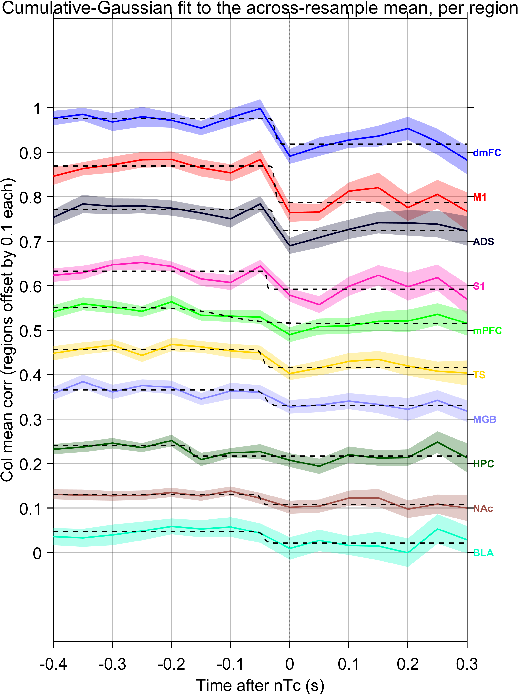
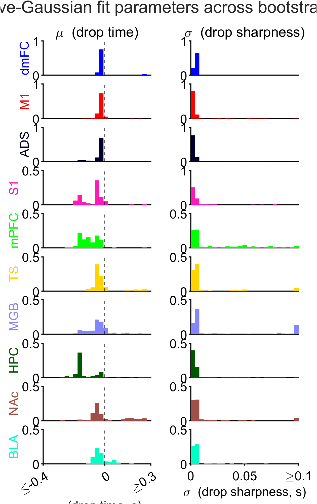
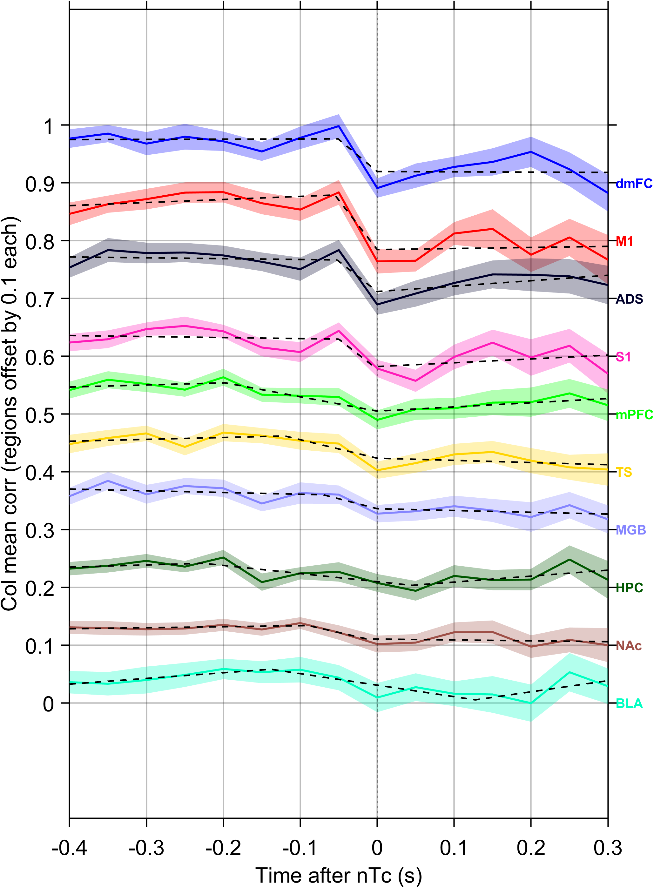

# Sigmoid fitting of click-on-DV influence around nTc (Fig. 6)

## Motivation

Bondy, Charlton, Luo et al. record simultaneously from 10 brain regions across both hemispheres in rats performing an auditory accumulation-of-evidence task, and find that decision-related activity across the brain reflects a single shared, time-varying decision state rather than independent per-region decisions. A central claim of the paper is that the neurally-inferred time of commitment (nTc) marks a coordinated brain-wide state change from decision formation to choice maintenance.

For the resubmission, Fig. 6 is being extended with a new analysis that directly tests a mechanistic prediction of this state change: if the brain commits to a choice at nTc, then after nTc the decision state in each region should stop being driven by new sensory evidence. This is assessed by correlating the binned left-minus-right click difference at time *t* with the future value of each region's decision variable (DV), yielding a per-region time course of click-on-DV influence that drops precipitously around nTc. To avoid circularity, for each region, nTc is estimated using only those neurons NOT in that region (i.e. leave-one-region-out nTc).

The analysis documented here quantifies that drop. We fit each region's click-on-DV influence curve with a sigmoid-shaped function so that the timing and sharpness of the transition can be summarized as a handful of parameters and compared across regions. We try two parameterizations: a four-parameter cumulative Gaussian — about the simplest sigmoid possible, and one whose mean and standard deviation map directly onto the drop's time and sharpness — and a six-parameter trilinear (flat–ramp–flat) function, which is more expressive and may fit the data more closely at the cost of parameters that no longer correspond one-to-one with the quantities of scientific interest. The goal of the analysis is to determine which of these two functional forms should be adopted in the paper for quantifying the click-on-DV drop across brain regions.

## Methods

### Computing the click-on-DV influence curves

The curves that the sigmoids are fit to are produced upstream by `make_dv_corr_data_fig_6.m` (in the `uberphys_paper` repository, under `code/figure_abruptCommitment/`). For each region, this code yields a curve describing how strongly momentary click evidence influences that region's decision variable, as a function of when the clicks occur relative to nTc. The procedure is summarized below; it pools all 19 sessions across 3 rats.

**Per-trial signals.** For each session and region, the decision variable DV(*t*) is the log-odds choice-axis projection used throughout the paper. The momentary sensory evidence is the binned left-minus-right click difference, Δclicks(*t*), in 50 ms bins. nTc is the leave-one-region-out estimate (computed from neurons outside the region under study, to avoid circularity; see Motivation).

**Demeaning.** To isolate trial-to-trial fluctuations from the stimulus- and choice-driven mean, both DV(*t*) and Δclicks(*t*) are demeaned within groups of trials sharing the same generative click rate (gamma): the across-trial mean within each gamma group is subtracted from each trial. Only trials with a detectable nTc are kept.

**Alignment to nTc.** Each trial's DV and Δclicks traces are realigned so that *t* = 0 is that trial's nTc. After alignment, Δclicks is retained over [−0.4, 0.3] s relative to nTc and DV over [−0.4, 0.6] s. Trials are then pooled across all sessions, keeping a session index for the hierarchical bootstrap (below).

**Click-on-DV cross-correlation.** For every pair of (DV time *t*<sub>DV</sub>, click time *t*<sub>click</sub>) the Pearson correlation across pooled trials between the demeaned DV(*t*<sub>DV</sub>) and the demeaned Δclicks(*t*<sub>click</sub>) is computed, giving a 2-D correlation matrix *r*(*t*<sub>DV</sub>, *t*<sub>click</sub>); the number of trials contributing to each entry is also recorded. Because a click can only influence the DV at the same or a later time, the informative entries lie on or below the diagonal *t*<sub>DV</sub> = *t*<sub>click</sub>, and each diagonal corresponds to a fixed lag τ = *t*<sub>DV</sub> − *t*<sub>click</sub> between a click and the DV it influences.

**Trial-count threshold.** Entries supported by fewer than 1200 trials are excluded. Because trials are aligned to nTc and have different durations, the number of contributing trials falls off at long lags; the 1200-trial floor keeps only well-estimated entries.

**Selecting which lags (diagonals) to include.** Not every lag carries a genuine click→DV signal. To decide which to keep, the correlation is averaged along each diagonal (lag) using *only click times before nTc* — the epoch in which clicks are known to drive the DV — and compared against a bootstrap noise floor. A lag is retained if its average pre-nTc click-on-DV correlation is significantly above chance for clicks at all pre-nTc timepoints. This yields a region-specific set of significant lags, chosen without reference to the post-nTc data whose change we are trying to characterize.

**Column mean — the influence curve.** For each click time *t*<sub>click</sub> (spanning both before and after nTc), the influence of clicks on the DV is summarized as the average of *r*(*t*<sub>DV</sub>, *t*<sub>click</sub>) over the DV times corresponding to the selected significant lags (i.e. *t*<sub>DV</sub> from *t*<sub>click</sub> + min τ to *t*<sub>click</sub> + max τ, subject to the trial-count threshold). Averaging the matrix down these columns gives one value per click time — the "column mean" — and stepping *t*<sub>click</sub> across the window traces out the click-on-DV influence curve *y*(*t*) that the sigmoids are fit to. Click times for which no selected lag survives the trial-count threshold are left undefined (NaN).

**Bootstrap.** The entire column-mean computation is repeated over *N* = 300 hierarchical bootstrap resamples (resampling sessions, then trials within sessions, via the session index), producing the bootstrap distribution of influence curves *y*<sup>(*b*)</sup>(*t*) that propagates through the sigmoid fits.

### Input to the sigmoid fits

For each brain region, the input to the fit is a time course *y*(*t*) giving the average correlation between the momentary click difference (binned left-minus-right clicks) and the future value of that region's decision variable, as a function of *t*, the time of the clicks relative to nTc — that is, the column-mean curve described above. For each region we have a bootstrap distribution of this time course, *N* = 300 resampled time courses *y*<sup>(*b*)</sup>(*t*), *b* = 1, …, *N*. The sigmoid fitting described below was performed independently for each region and each bootstrap resample, so that the fitted parameters and fitted curves inherit a bootstrap distribution.

### Cumulative Gaussian model

The cumulative Gaussian model has four parameters and is defined as

```
f(t; μ, σ, A, c) = A · Φ((t − μ) / σ) + c,
```

where Φ is the standard normal CDF. The mean μ is the inflection point of the sigmoid and is directly interpretable as the time of the drop in click-on-DV influence; the standard deviation σ > 0 controls the width of the transition and is interpretable as its sharpness; *A* is a signed amplitude (negative when influence drops over time); and *c* is a vertical offset.

The model is linear in (*A*, *c*) at fixed (μ, σ). We exploit this by variable projection: at each candidate (μ, σ), the optimal (*A*, *c*) is obtained in closed form by ordinary least squares against the design matrix `[Φ((t − μ) / σ), 1]`, and the residual is profiled back to the two-dimensional nonlinear problem in (μ, σ), which is solved with `lsqnonlin` (MATLAB Optimization Toolbox, trust-region-reflective). This is faster than a naive four-dimensional nonlinear fit and substantially reduces start-point sensitivity. We constrain μ ∈ [min *t*, max *t*] and σ ∈ [10⁻³, (max *t* − min *t*) / 2]. To guard against local minima we use a multi-start strategy with a 5 × 3 grid of (μ, σ) initial guesses spanning the data range. The fit with the lowest sum-of-squared residuals across starts is retained.

### Trilinear model

The trilinear model has six parameters and is the continuous piecewise-linear function

```
f(x) = y₀ + m₁ · (x − x₁)                              for x ≤ x₁
f(x) = y₀ + m₂ · (x − x₁)                              for x₁ < x ≤ x₂
f(x) = y₀ + m₂ · (x₂ − x₁) + m₃ · (x − x₂)             for x > x₂
```

where *m*₁, *m*₂, *m*₃ are the slopes of the three line segments, *x*₁ < *x*₂ are the two breakpoints, and *y*₀ = *f*(*x*₁) is a vertical offset. Continuity across breakpoints is guaranteed by construction. We constrain *x*₁ to lie in the first half of the data range. All six parameters are fit simultaneously by nonlinear least squares (`lsqcurvefit`). To guard against local minima, three initial guesses are tried — a thirds split of the time range, a narrow middle segment centred near *t* = 0, and a "flat-ramp-flat" configuration in which only the middle slope is non-zero — and the lowest-residual fit is retained.

### Bootstrap fitting strategy

For each region, the model (cumulative Gaussian or trilinear) is first fit to the across-resample mean time course *ȳ*(*t*) = (1 / *N*) Σ<sub>*b*</sub> *y*<sup>(*b*)</sup>(*t*). The resulting parameter vector is then supplied as a warm-start initial guess (in addition to the automatic starts described above) when fitting each individual bootstrap resample. The intent is to anchor the per-resample fits in a basin of attraction consistent with the average curve, while still allowing each resample to pull the fit independently within that basin. The output of the procedure, for each region and each model, is a set of *N* fitted parameter vectors and *N* fitted curves evaluated on a common, finely sampled time grid, from which means, standard deviations, and bootstrap confidence intervals on both the fitted curves and the fitted parameters can be computed.

## Results

### Cumulative Gaussian fits

The results of the cumulative Gaussian fits are summarised in Figs. 1 and 2.



**Fig. 1.** Cumulative-Gaussian fits to the click-on-DV influence curve, by region. Each panel shows one of the ten brain regions. Black points with error bars are the data: the mean across bootstrap resamples and the 95% bootstrap CI of the click-on-DV correlation as a function of click time relative to nTc (x-axis, seconds; nTc indicated by the dashed vertical line at 0). The blue line is the mean across resamples of the fitted cumulative Gaussian; the shaded band is ±1 standard deviation across resamples of the fit.



**Fig. 2.** Bootstrap distributions, by region, of the two cumulative-Gaussian parameters most directly tied to the scientific claim. Left column: histogram across the *N* = 300 bootstrap resamples of μ, the time of the drop in click-on-DV influence relative to nTc (seconds; dashed line at 0). Right column: histogram across resamples of σ, the width of the drop in seconds; values ≥ 0.1 s are clipped to the upper edge of the axis.

Two features of the fits stand out. First, in nearly every region the drop in click-on-DV influence is well captured by a sigmoid centred just before nTc. Across regions, the bootstrap distribution of μ is concentrated at small negative values (typically tens of milliseconds before nTc). Some regions (NAc, mPFC, HPC) show broader μ distributions reflecting weaker signals and noisier fits. Second, the drop is remarkably sharp in the frontal and striatal regions most strongly implicated in decision formation and commitment in earlier figures: dmFC, M1, ADS, and S1 all have σ distributions tightly concentrated below 10 ms (Fig. 1, R1–R4). Given the bin size (50ms) this means effectively step-like transitions.  Other regions — mPFC, TS, MGB, NAc — show broader and in some cases bimodal σ distributions, with a subset of bootstrap resamples driven to the upper bound on σ (visible as the rightmost bar in Fig. 2), indicating that the sharpness of the transition is less well constrained in those regions. Taken together, the cumulative Gaussian fits provide a compact quantitative confirmation that the click-on-DV drop occurs at or just before nTc across the brain, and that it is sharpest in the same subnetwork of frontal cortical and anterior striatal regions that previous analyses in the paper identify as carrying the strongest and earliest decision and commitment signals.

### Trilinear fits



**Fig. 3.** Trilinear fits to the click-on-DV influence curve, by region. Each panel shows one of the ten brain regions. Black points with error bars are the data: the mean across bootstrap resamples and the 95% bootstrap CI of the click-on-DV correlation as a function of click time relative to nTc (x-axis, seconds; nTc indicated by the dashed vertical line at 0). Coloured lines show the trilinear fits obtained from the first four bootstrap resamples (one colour per resample), rather than a summary across resamples, to make the per-resample variability of the fit visible.

The trilinear model has two additional parameters compared to the cumulative Gaussian, allowing it in principle to capture features of the time course that a symmetric sigmoid cannot. In practice, this additional expressiveness is largely spent fitting idiosyncratic features of each bootstrap resample that are unrelated to the drop itself.

In the frontal and striatal regions where the drop is most pronounced (dmFC, M1, ADS, S1), there is a regime in which the trilinear fits become straightforwardly interpretable: on resamples where the fitter places the two breakpoints around the drop, the three segments take on clear roles — the first segment captures a pre-nTc baseline (now allowed a non-zero slope), the second segment captures the drop itself, and the third segment captures a post-nTc steady state (also allowed to be non-flat). In this regime the second segment is near-vertical in these regions, leading to the same qualitative conclusion as the cumulative Gaussian fits: the transition is effectively step-like.

## Conclusion

We set out to quantify the precipitous drop in the influence of momentary click evidence on each region's decision variable around the neurally-inferred time of commitment, and to choose between two sigmoid parameterisations for doing so. This helps quantify the claim that, for most regions, the drop occurs at or just before nTc, and that it is sharp -- essentially step-like in the frontal cortical and striatal regions (dmFC, M1, ADS, S1) most strongly implicated in decision formation and commitment elsewhere in the paper. The two parameterisations differ in their interpretability: the cumulative Gaussian's μ and σ map directly onto the time and sharpness of the drop, while the additional flexibility of the trilinear is mostly spent fitting bootstrap-to-bootstrap noise features unrelated to the transition. Even for resamples where the trilinear fit captures the relevant data features, it leads to a qualititatively similar conclusions to the cumulative Gaussian fits. We therefore plan to adopt the cumulative Gaussian for the new Fig. 6 panels: the mean cumulative-Gaussian fit will be overlaid on the per-region click-on-DV influence curves, and the bootstrap distributions of μ and σ (Fig. 2 here) will be added as new panels summarising drop timing and sharpness across regions.
